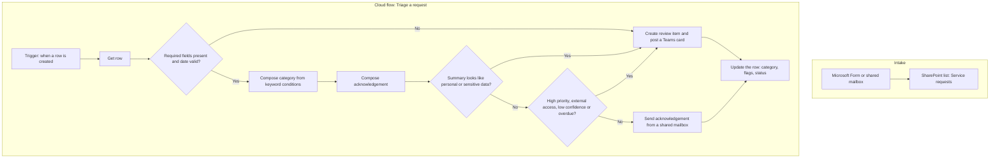

# Power Automate flow design

The brief says a clearly documented workflow is acceptable where a licence is not available to run one. This is that design. It carries the same decisions as `python -m triage`: check the row, categorise it, draft the acknowledgement, and route the exceptions to a person.

The Python prototype is the thing that runs today. This flow is how the same rules would sit in the Microsoft 365 tools the role uses, once a Power Automate licence and a SharePoint list (or Dataverse table) are available.

## Where it sits

## List columns

Match the spreadsheet, and add the columns the flow fills in.

| Column | Type | Written by |
| --- | --- | --- |
| Title | Single line | The request id, e.g. REQ-001 |
| Submitted | Date | The form |
| RequesterRole | Choice or text | The form |
| SubmittedType | Choice | The form, optional |
| Summary | Multiple lines | The form |
| Priority | Choice: Low, Medium, High | The form |
| Channel | Choice | The form |
| Status | Choice: New, In Review, Assigned, Planned, In Progress, Completed | The form, then the flow |
| RuleCategory | Choice, including Uncategorised | The flow |
| Confidence | Choice: high, medium, low, none | The flow |
| NeedsReview | Yes/No | The flow |
| ReviewReasons | Multiple lines | The flow |
| Acknowledgement | Multiple lines | The flow |
| AckSource | Choice: template, ai | The flow |

## Trigger

**When an item is created** (SharePoint). Filter so the flow does not run again when it updates its own columns: only run when `RuleCategory` is empty.

A second scheduled flow, once a weekday morning, can re-check rows still in `New` and set `NeedsReview` when `Submitted` is more than five days ago. That is the overdue rule. Splitting it out keeps the item flow simple.

## Validation

A **Condition** with one **And** group:

- `Title` is not empty, and matches `REQ-` plus digits (an expression, or a preceding **Compose** that uses `startsWith`).
- `Submitted` is not empty and is on or before `utcNow()`.
- `RequesterRole`, `Summary`, `Priority`, `Channel` and `Status` are not empty.
- `Priority` is one of Low, Medium, High.
- `length(Summary)` is at least 15.

If the condition fails, skip categorisation. Set `NeedsReview` to Yes and set `ReviewReasons` to the names of the blank or invalid fields. Still write a short acknowledgement that says the team will ask for the missing information. That is the `incomplete_note` in `config/acknowledgements.json`.

## Categorisation

Power Automate has no tidy equivalent of the weighted scores in `triage/categoriser.py`, and pretending it does makes the flow unreadable. Use a **switch** or a chain of conditions on the summary, in the same spirit as the strong keywords:

1. If the summary contains `dashboard`, `report` or `weekly summary` → Reporting & Analytics.
2. Else if it contains `automate`, `automated` or `reminder` → Process Automation.
3. Else if it contains `connect`, `synchronise` or `sync` → System Integration.
4. Else if it contains `access`, `permission` or `password` → Access & Permissions.
5. Else if it contains `guide`, `template` or `publish` → Content & Guidance.
6. Else → Uncategorised, and `NeedsReview` = Yes.

Order matters, and it is coarser than the Python scores. Two consequences, both acceptable in a flow:

- Put the checks in the order above so "Connect the expenses form..." lands on System Integration (step 3) before a later rule sees "form".
- Where the Python prototype reports medium or low confidence (REQ-004 is the example in the supplied file), the flow should set `NeedsReview` to Yes whenever two of these keyword groups match. A second **Compose** can count matches. If the count is greater than one, a person looks at it. That is the mismatch and low-confidence behaviour, expressed with conditions instead of weights.

If `SubmittedType` is filled in and differs from `RuleCategory`, append `CATEGORY_MISMATCH` to `ReviewReasons`.

## Acknowledgement

A **Compose** action with the template from `config/acknowledgements.json`. Power Automate expressions fill the reference, the date (`formatDateTime`), the category and the response target:

| Priority | Response target |
| --- | --- |
| High | 1 working day |
| Medium | 3 working days |
| Low | 5 working days |

A second **Compose** holds the category note (the six paragraphs in the JSON file), selected with a **Switch** on `RuleCategory`.

Do not call an AI connector from this flow until the sensitive-content condition below has passed. If you add an AI Builder or Azure OpenAI action later, feed it the same small set of fields the Python prompt uses, and keep the Compose output as the fallback when the action fails or the reply does not contain the request id.

## Human review

Set `NeedsReview` to Yes when any of these are true. Append a short reason each time, so the Teams card can show it.

- Validation failed.
- Category is Uncategorised, or two keyword groups matched.
- `SubmittedType` disagrees with `RuleCategory`.
- Priority is High.
- Category is Access & Permissions and the summary contains `external`, `guest`, `partner` or `collaborator`.
- The summary contains `@` (possible email address), or the words `password`, `disability`, `medical`, `grievance`.
- The request id already exists on another row (**Get items** with a filter, count greater than 1).

The sensitive-content check is the gate in front of any AI action and in front of **Send an email**. A row that trips it is reviewed by a person. The flow does not forward the summary to an external model.

## Send, or don't

**Condition:** `NeedsReview` is false.

- **Yes:** **Send an email (V2)** from a shared mailbox, body = the acknowledgement, subject = `We have received your request {Title}`. Then set Status to `In Review`.
- **No:** do not send. **Post adaptive card in a chat or channel** to the service-desk channel. The card shows the request id, priority, category and `ReviewReasons`, and a link to the list item. Set Status to `In Review` only after a person opens it; leave it `New` until then so the morning overdue flow can still see it.

## What this flow deliberately leaves in Python

The weighted scoring, the whole-word matching and the personal-data patterns are easier to test in `triage/` than inside nested conditions. If the flow had to stay exact, a small Azure Function or a **Run a script** action could call the same `triage` package and write the JSON result back to the columns. The flow would then only own the trigger, the email and the Teams card. That is the better production shape: one implementation of the rules, two ways to run it.

## What I could not execute

I do not have a Power Automate licence or a university tenant for this test, so this flow has not been imported or run. The behaviour it describes is the behaviour the Python prototype and the tests already demonstrate.
